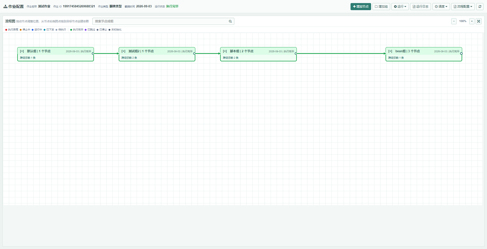
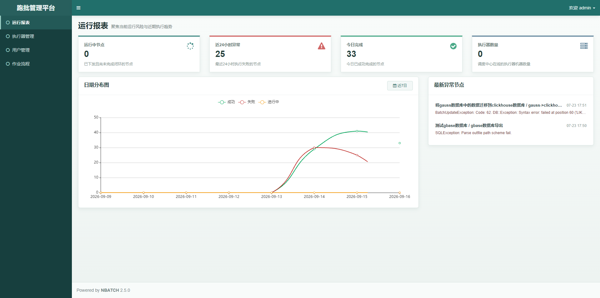

# nbatch

[English](README_EN.md)

`nbatch` 是基于 Spring Boot 的批量作业调度与流程编排平台。管理端负责调度、编排和运行管控；执行器负责实际执行 SQL、脚本、存储过程及文件任务。平台适用于日批、数据同步、文件交换和需要依赖控制、可观测日志与可恢复执行的数据处理场景。

## 目录

- [核心能力](#核心能力)
- [快速开始](#快速开始)
- [操作说明](#操作说明)
- [运行与重试](#运行与重试)
- [日志与排障](#日志与排障)
- [生产建议](#生产建议)

## 核心能力

- **可视化流程编排**：使用流程图管理组、节点和依赖；支持节点拖拽、画布缩放、自动布局和依赖维护。
- **丰富节点类型**：支持脚本、SQL、存储过程、带返回值的存储过程、文件导入数据库、数据库导出文件和 Spring Bean。
- **可靠运行控制**：支持停止、作业重跑、节点重跑、连同下游节点重跑和异常/停止后的恢复重跑。
- **运行可观测性**：首页展示运行概览、日期趋势和最新异常节点；节点日志可按作业、组、节点和创建时间筛选。
- **批量维护**：流程配置支持导入、导出与模板下载。工作簿按“组、各节点类型、依赖关系”分 Sheet 管理，并提供示例数据。
- **多数据源与文件处理**：执行器可配置 openGauss、GaussDB、ClickHouse 与 GBase 数据源，支持常见文件导入、导出和压缩场景。

## 架构

```text
Browser
  |
  v
nbatch-admin (8095/nbatch) <--- registration / dispatch / callback ---> nbatch-consumer (8097)
  |                                                                       |
  v                                                                       v
MySQL metadata                                                     business data sources
                                                                    files / scripts / beans
```

| 模块 | 职责 |
| --- | --- |
| `nbatch-core` | 调度、执行器通信、公共模型和回调协议。 |
| `nbatch-handler` | 节点处理器与文件工具。 |
| `nbatch-admin` | 管理端、流程编排、调度、运行控制和日志查询。 |
| `nbatch-consumer` | 示例执行器，注册到管理端并执行节点。 |
| `sql` | 新环境初始化脚本和存量环境升级脚本。 |

## 运行要求

- JDK 8
- Maven 3.6+
- MySQL 8.x，用于管理端元数据
- 可选：openGauss、GaussDB、ClickHouse、GBase，按节点实际使用情况配置

项目使用 Spring Boot 2.7.18、MyBatis-Plus、Freemarker、Netty、Hutool 与 EasyExcel。GBase 和 GaussDB 驱动可能不在公共 Maven 仓库中；仓库已提供本地驱动文件时，可按 [config/lib/mvn-add.txt](config/lib/mvn-add.txt) 安装到本地 Maven 仓库，或改为从企业私服获取。

## 快速开始

### 1. 创建本地配置

```powershell
Copy-Item .env.example .env
```

Linux/macOS：

```bash
cp .env.example .env
```

至少确认以下配置：

- `NBATCH_ADMIN_DATASOURCE_URL`、`NBATCH_ADMIN_DATASOURCE_USERNAME`、`NBATCH_ADMIN_DATASOURCE_PASSWORD`
- `NBATCH_ACCESS_TOKEN`：管理端与所有执行器必须完全一致；生产环境必须替换默认值
- `NBATCH_ADMIN_ADDRESSES`：指向实际管理端地址
- `NBATCH_EXECUTOR_IP`、`NBATCH_EXECUTOR_PORT`：管理端可访问的执行器地址

完整配置项和说明见 [.env.example](.env.example)。`.env` 包含凭据和令牌，不应提交到版本库。

### 2. 初始化数据库

创建 MySQL 数据库后导入初始化脚本：

```bash
mysql -u <username> -p <database> < sql/init/mysql.sql
```

初始化脚本仅用于新环境，包含表删除与重建操作。已有环境升级前先备份数据库，再按版本顺序执行 [sql/update](sql/update) 中的脚本。

### 3. 构建并启动

```bash
# 管理端
mvn -pl nbatch-admin -am -DskipTests package
java -jar nbatch-admin/target/nbatch-admin-2.5.0.jar

# 示例执行器
mvn -pl nbatch-consumer -am -DskipTests package
java -jar nbatch-consumer/target/nbatch-consumer-2.5.0.jar
```

> **本地登录**
>
> - 管理端：`http://localhost:8095/nbatch`
> - 账号：`admin`
> - 密码：`123456`

首次登录后请立即修改默认管理员密码。生产环境还应替换访问令牌并使用 HTTPS。

## 配置参考

应用启动时通过 `spring.config.import=optional:file:.env[.properties]` 读取仓库根目录的 `.env`。

| 配置分组 | 关键变量 | 说明 |
| --- | --- | --- |
| 管理端数据源 | `NBATCH_ADMIN_DATASOURCE_*` | MySQL 元数据连接。 |
| 接口认证 | `NBATCH_ACCESS_TOKEN` | 管理端与执行器共享令牌。 |
| 执行器注册 | `NBATCH_ADMIN_ADDRESSES`、`NBATCH_EXECUTOR_*` | 管理端地址、执行器标识、地址、端口和目录。 |
| 文件处理 | `NBATCH_CONSUMER_FILE_*` | 执行器临时文件与远程文件落地目录。 |
| 业务数据源 | `NBATCH_OPEN_GAUSS_*`、`NBATCH_GAUSS_DB_*`、`NBATCH_CLICKHOUSE_*`、`NBATCH_GBASE_*` | 按节点实际使用情况配置。 |
| 邮件和保留期 | `NBATCH_MAIL_*`、`NBATCH_*_LOG_RETENTION_DAYS` | 告警邮件和日志清理策略。 |

执行器启动后，在“执行器管理”中确认它已注册且至少有一台机器在线。未注册或不在线时，节点无法下发。

## 操作说明

### 首次使用路径

1. 启动管理端和执行器，在“执行器管理”确认至少有一台执行器在线。
2. 在“作业流程”新增作业，设置执行器和调度方式。
3. 进入“作业配置”，增加组和节点，再在流程图上创建依赖。
4. 启动定时，或在满足运行条件后执行重跑；通过运行日志确认执行结果。

> `启动定时`只允许后续时间点触发，`停止当前批次`才会请求停止已下发或运行中的节点。

### 页面入口

| 页面 | 日常用途 |
| --- | --- |
| 运行报表 | 查看运行中节点、近期异常、完成量、执行器数量和异常节点。 |
| 执行器管理 | 确认执行器已注册且有在线地址；作业无法下发时优先检查此处。 |
| 作业流程 | 创建作业、配置调度，并进入流程图编排和运行控制。 |

在“作业流程”创建作业时，先配置执行器、调度类型和 Cron/周期；随后从列表进入该作业的“作业配置”页面。

### 顶部工具栏

作业配置页将操作按使用场景分组：

| 区域 | 操作 | 说明 |
| --- | --- | --- |
| 对象 | 增加节点、增加组 | 新对象会加入当前流程图；默认组只能修改名称，不能删除。 |
| 运行 | 重跑作业、停止当前批次、恢复重跑 | 按当前运行状态显示可执行操作；翻牌作业重跑时可选择日期。 |
| 日志 | 运行日志 | 默认查看当前作业；选中组或节点后会自动带入对应范围。 |
| 调度 | 启动定时、停止定时 | 只控制后续定时触发，不等同于停止已经下发的节点。 |
| 流程配置 | 下载配置模板、导入流程配置、导出流程配置 | 用于批量维护组、节点和依赖。 |
| 画布 | 刷新并自动布局 | 重新读取流程数据并按依赖关系整理布局。 |

新增、编辑、删除对象以及创建、删除依赖均在操作成功后立即保存，无需额外点击“保存流程”。

### 流程图操作

1. 在流程图顶部搜索框输入节点或组名称、ID；选择搜索结果后，画布会自动定位并选中该对象。
2. 点击组标题中的 `[-]` 或 `[+]` 收起、展开组。拖动组会整体移动组内节点；拖动节点只调整该节点位置，组会自动扩展以容纳节点。
3. 从节点或组右侧圆点拖向目标节点或组，创建“前置 -> 后置”依赖。箭头表示前置对象完成后，后置对象才可执行。
4. 点击节点、组或依赖线，画布旁会出现相关操作按钮：节点可查看日志、重跑、编辑、删除；组可查看日志、编辑、删除；依赖线仅支持删除。
5. 使用 `-`、`+` 调整缩放，使用适配画布按钮恢复到合适视图。长流程优先使用搜索和适配画布定位。

所有删除均需二次确认。删除组会同时删除组内节点、相关依赖和节点文件配置；删除节点会清理其依赖和文件配置。组也可以参与依赖关系。



### 导入与导出

在流程配置的导入导出入口可以下载模板、导出当前定义或导入工作簿。工作簿顺序如下：

1. `组`
2. 每种节点类型各一个 Sheet
3. `依赖关系`

节点类型 Sheet 只包含该类型必要字段，模板自带示例行。导入前应先检查节点 ID、组归属、数据源名称、执行内容和依赖引用，避免覆盖或引入错误的流程定义。

## 运行与重试

节点每次下发都会产生独立执行日志。翻牌作业按业务日期推进，顺序作业维护当前流程运行状态；排查同一节点的多次执行时，结合日志中的 `turnDate`、创建时间、开始时间和结束时间判断。

| 操作 | 用途 |
| --- | --- |
| 停止当前批次 | 向执行器发送停止请求，并等待当前活动节点完成停止闭环；“停止定时”不会停止当前批次。 |
| 重跑作业 | 从顶部“运行”菜单执行，重置当前作业运行状态并按当前定义重新执行。翻牌作业可指定重跑日期。 |
| 重跑节点 | 选中节点后从悬浮操作按钮执行；执行前会校验下游节点是否正在运行。 |
| 重跑依赖节点 | 在节点重跑弹窗中勾选，将目标节点及其下游依赖节点回拨，避免下游使用旧结果。 |
| 恢复重跑 | 从顶部“运行”菜单执行，继续异常或已停止的节点，已完成和已跳过节点不重复执行。 |

失败策略支持停止、跳过和重试。重试次数的含义如下：

- `-1`：无限重试
- `0`：不重试
- 大于 `0`：最多重试对应次数

对会写库、发送文件或调用外部系统的节点，请先保证幂等性。强制恢复会跳过旧任务退出确认，旧任务未退出时可能与新尝试并发执行，仅应在已确认风险后使用。

### 高频操作速查

| 目标 | 推荐操作 |
| --- | --- |
| 暂停后续定时触发 | 顶部“调度” -> “停止定时”。 |
| 终止正在执行的批次 | 顶部“运行” -> “停止当前批次”。 |
| 仅重新执行一个节点 | 选中节点 -> 悬浮工具条 -> 重跑节点。 |
| 重新执行节点及下游 | 选中节点 -> 重跑节点 -> 勾选“依赖节点重跑”。 |
| 接续异常或已停止节点 | 顶部“运行” -> “恢复重跑”。 |

## 日志与排障

### 日志查询

“运行日志”可从顶部工具栏打开。选中组或节点后再打开日志，会默认带入该组或节点；也可在日志弹窗的“日志范围”输入框中搜索并切换范围：

- 选择“当前作业”：查询该作业所有节点日志。
- 选择指定组：查询该组内节点日志。
- 选择指定节点：查询该节点日志。
- 清空“日志范围”：恢复查询当前作业全部日志。

创建时间可与范围组合筛选。执行日志和详细日志均显示节点名称、节点 ID、运行日期、状态、执行信息及实际执行时间；长文本可悬停查看完整内容。

### 排障顺序

1. 在运行报表确认是否存在最新异常节点或运行中节点。
2. 在执行器管理确认目标执行器在线，并检查其地址是否可从管理端访问。
3. 打开节点运行日志，确认最近一次日志的状态、`turnDate`、创建时间和执行信息。
4. 再检查目标数据源连接、文件目录权限、磁盘空间和网络连通性。



## 开发与验证

```bash
# 构建全部模块
mvn clean package -DskipTests

# 运行管理端测试；根 POM 默认跳过测试，需要显式覆盖
mvn -pl nbatch-admin -am -Dmaven.test.skip=false test
```

## 生产建议

- 不要使用默认账号、默认访问令牌或示例数据源密码。
- 使用 HTTPS，并限制管理端、执行器、数据库和文件目录的网络与操作权限。
- 定期备份 MySQL 元数据；升级前验证升级脚本，并在测试环境演练。
- 为文件任务设置可控的目录、磁盘容量和来源校验；避免将不可信路径直接交给执行器。
- 为 SQL、脚本和存储过程配置最小权限账号，并为重跑建立业务幂等保障。

## License

本项目按仓库中的 [LICENSE](LICENSE) 发布。
